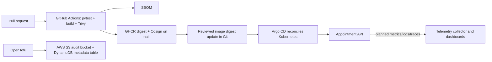

# Architecture, trade-offs and ADRs for CTO Maya Chen

## Proposed reference architecture (demonstration, not a deployed production system)

**Important gap:** the demo API stores data in memory and does not yet connect to DynamoDB; the two AWS resources are infrastructure examples, not integrated production backing stores. There is no authenticated patient access, multi-tenant authorization, encryption at the application level, or HIPAA compliance review. Do not place real patient data in this demonstration.

## ADR-001: GitOps and human-reviewed promotion
Choose Argo CD reconciliation driven by a Git pull request rather than direct `kubectl apply` from the CI pipeline. This creates a reviewable desired-state record and reduces manual drift. Trade-off: another control plane and explicit image promotion step. Requires installed Argo CD, a cluster, and repository access. The current demonstration uses a commit-tagged container image in k8s/deployment.yaml. Argo CD automatically reconciles approved changes from the main branch, and the deployment has been verified as Synced and Healthy in the local Kubernetes cluster. Future production releases should use reviewed pull requests and immutable image digests for stronger change control.
## ADR-002: Infrastructure and remote state
Choose OpenTofu for repeatable AWS S3 + DynamoDB resources and a remotely stored, encrypted S3 state object with S3 locking. Bootstrap a separate state bucket and IAM access **before** running `tofu init -backend-config=backend.hcl`; the demo should use isolated credentials with a cost budget. State can expose infrastructure details: restrict reads, audit writes, use versioning, encryption, and lock support.

## ADR-003: Data and privacy boundary
Use only synthetic appointment references. In production replace in-memory storage with a validated persistent backend and implement identity verification, role-based access, audit events, encryption in transit, data retention, tested backups, and an applicable regulatory compliance review before any patient onboarding.

## Threats and gates
Unreviewed code -> PR protection; vulnerable image -> Trivy fail; unsigned image -> sign and verify; misconfigured infra -> OpenTofu plan review; drifting deployment -> Argo CD self-heal; silent failure -> multi-signal observability and incident response. The last two security/monitoring verifications are **planned** rather than implemented in this starter.
